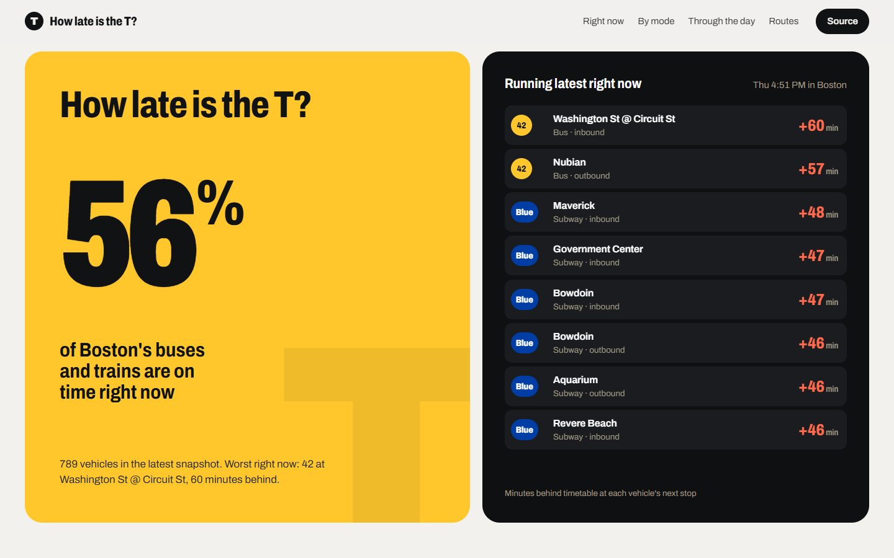
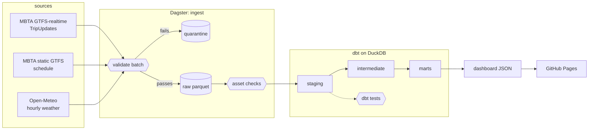

<p align="center"></p>

<h1 align="center">Headway</h1>

<p align="center"><b>How late is the T, really?</b><br>A Dagster, dbt and DuckDB pipeline that checks every Boston bus and train against the timetable every 30 minutes, with a live dashboard.</p>

[](https://github.com/alok-kul5/headway-transit/actions/workflows/ci.yml)
[](https://github.com/alok-kul5/headway-transit/actions/workflows/pipeline.yml)

**Live dashboard: <https://alok-kul5.github.io/headway-transit/>**

Every 30 minutes this pipeline snapshots every bus and train in Boston's **MBTA**
real-time feed, works out how late each vehicle is against its published timetable,
joins the weather for that hour, and republishes a dashboard. It is orchestrated with
**Dagster**, modelled with **dbt**, and stored in **DuckDB**. Three layers of data
quality checks stop bad data before it reaches the dashboard.



## Architecture



| Layer | Where | What it holds |
|---|---|---|
| **raw** | `data/raw/*.parquet` | One file per real-time snapshot (the *next* stop of each active trip, with its scheduled time), the latest static schedule, and hourly weather |
| **staging** | `dbt/models/staging` | Typed, de-duplicated views over the raw files |
| **intermediate** | `int_delay_observations` | Only rows that measure a real delay (see *Method*) |
| **marts** | `fct_delay_observations` + 4 aggregates | One row per vehicle per snapshot, with route, stop and weather; delay by hour, by route, by weather, and over time |

### Dagster asset graph

```
raw/gtfs_routes ─┐
raw/gtfs_stops ──┤
raw/gtfs_stop_times ─► raw/trip_updates ─► staging/* ─► intermediate/* ─► marts/* ─► dashboard_data
raw/weather_hourly ──────────────────────┘
```

`collect_and_build` materialises everything. It runs every 15 minutes under
`dagster dev`, and every 30 minutes in GitHub Actions for the live site.

## Data quality: how bad data is stopped

| Layer | Mechanism | Examples |
|---|---|---|
| **1. Batch validation** (`transit_pipeline/quality.py`) | Runs inside the ingest asset *before anything is written*. A failing batch is saved to `data/quarantine/<time>/` with a `problems.json`, and the asset raises `Failure`, so no downstream asset runs. | Feed header more than 15 min old · fewer than 50 trips in a daytime snapshot · duplicate trips · empty IDs · predictions more than 6h away · under 30% of scheduled trips match the timetable (static and real-time feeds out of sync) · weather out of range, negative rain, or missing hours |
| **2. Dagster asset checks** (`assets/ingest.py`) | Checks on the *accumulated* raw data. The blocking ones stop dbt from running. | Every snapshot stored exactly once · no weather gaps longer than 3h · the static schedule hasn't expired · a warning if collection stalls for 2h |
| **3. dbt tests** (`dbt/models/**/_*.yml`, `dbt/tests/`) | `dbt build` runs each model's tests right after it. A failing test skips every model downstream. Dagster shows each test as an asset check. | Uniqueness of (snapshot, trip) · valid GTFS enums · delays within ±4h · every route in the fact table exists in the schedule · the newest snapshot made it into the marts (catches joins that silently drop rows) · percentages between 0 and 100 |

`tests/test_pipeline.py` proves layer 1 works end to end. It feeds a two-hour-old feed
through the real Dagster job and asserts that the batch is quarantined, nothing is
written to raw, and dbt and the dashboard export don't run.

## Method

* **Delay** = predicted arrival at the vehicle's *next* stop − scheduled arrival at that stop.
  Only predictions for a stop the vehicle reaches **within 10 minutes** count. A
  prediction that close is effectively the vehicle's current delay, while one an hour
  out is a guess.
* **On time** = between 1 minute early and 5 minutes late, the window most US agencies report against.
* The scheduled time is looked up **when the snapshot is taken**, not later. GTFS trip
  IDs change whenever the MBTA publishes a new schedule, so a later join would quietly
  lose old snapshots.
* GTFS times are measured from "noon minus 12 hours" on the service day, so `25:30:00`
  is 1:30 the next morning. That reference point also keeps times correct on the days
  the clocks change. There is a test for both DST days.
* Only trips that run to a timetable are included. Subway trips added on the fly have no
  scheduled time, so there's nothing to be late against.
* Weather is the Open-Meteo hourly value for downtown Boston, joined on the hour.

## Analysis

The write-up is in **[`analysis/REPORT.md`](analysis/REPORT.md)**: when and where
delays happen, which routes are worst, and whether rain and cold make them worse.
`analysis/make_figures.py` regenerates its charts from the warehouse.

## Running it locally

```bash
python -m venv .venv && source .venv/bin/activate      # Windows: .venv\Scripts\activate
pip install -r requirements-dev.txt
cd dbt && dbt parse && cd ..

# One run of the whole pipeline
dagster job execute -m transit_pipeline.definitions -j collect_and_build

# Or the UI, with the 15-minute schedule
dagster dev            # http://localhost:3000

# View the dashboard
python -m http.server -d site 8000
```

Explore the warehouse directly:

```bash
duckdb data/warehouse.duckdb "select mode, median(delay_min), avg(is_on_time::int) from marts.fct_delay_observations group by 1"
```

Tests and lint:

```bash
pytest          # unit tests + a full Dagster/dbt run on synthetic data
ruff check .
```

## How the live site is kept up to date

[`.github/workflows/pipeline.yml`](.github/workflows/pipeline.yml) runs on a 30-minute schedule:

1. Restores the raw snapshots from the `data` branch.
2. Runs `collect_and_build`: ingest, validate, every check, `dbt build`, and the export.
3. Writes the raw data back to `data` as a **single orphan commit**, so the branch never
   builds up history. Snapshots older than 60 days are pruned.
4. Deploys `site/` to GitHub Pages, but only if every step passed. Bad data never
   reaches the live page.

## Project layout

```
transit_pipeline/
  sources/        gtfs_static.py · gtfs_rt.py · weather.py   (fetch + parse, no Dagster)
  assets/         ingest.py (raw assets + checks) · dbt.py (dbt models as assets)
  quality.py      batch validation rules
  export.py       marts → site/data/*.json
  definitions.py  Dagster Definitions, job and schedule
dbt/              staging → intermediate → marts, generic + singular tests
site/             static dashboard (Chart.js)
analysis/         write-up and figures
tests/            pytest
```

## Data & licence

Transit data © MBTA, under the [MassDOT Developers License Agreement](https://www.mass.gov/files/documents/2017/10/27/develop_license_agree_0.pdf).
Weather data from [Open-Meteo](https://open-meteo.com/) (CC BY 4.0). Code is MIT licensed.

---

<sub>One of eight projects by [Alok Kulkarni](https://alok.is-a.dev): [Hearth](https://github.com/alok-kul5/hearth-iot) home sensors · **Headway** transit data · [Vigil](https://github.com/alok-kul5/vigil-soc) security triage · [Loupe](https://github.com/alok-kul5/loupe-vision) defect inspection · [Kharcha](https://github.com/alok-kul5/kharcha-finance) personal finance · [Stockroom](https://github.com/alok-kul5/stockroom-inventory) inventory · [Quietwire](https://github.com/alok-kul5/quietwire-villa) smart home design · [Canopy](https://alok.is-a.dev/canopy/) coffee storefront.</sub>
